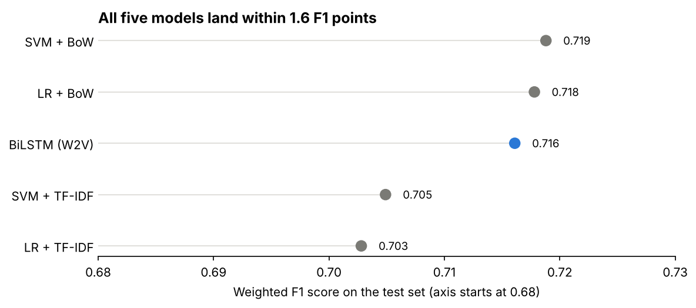
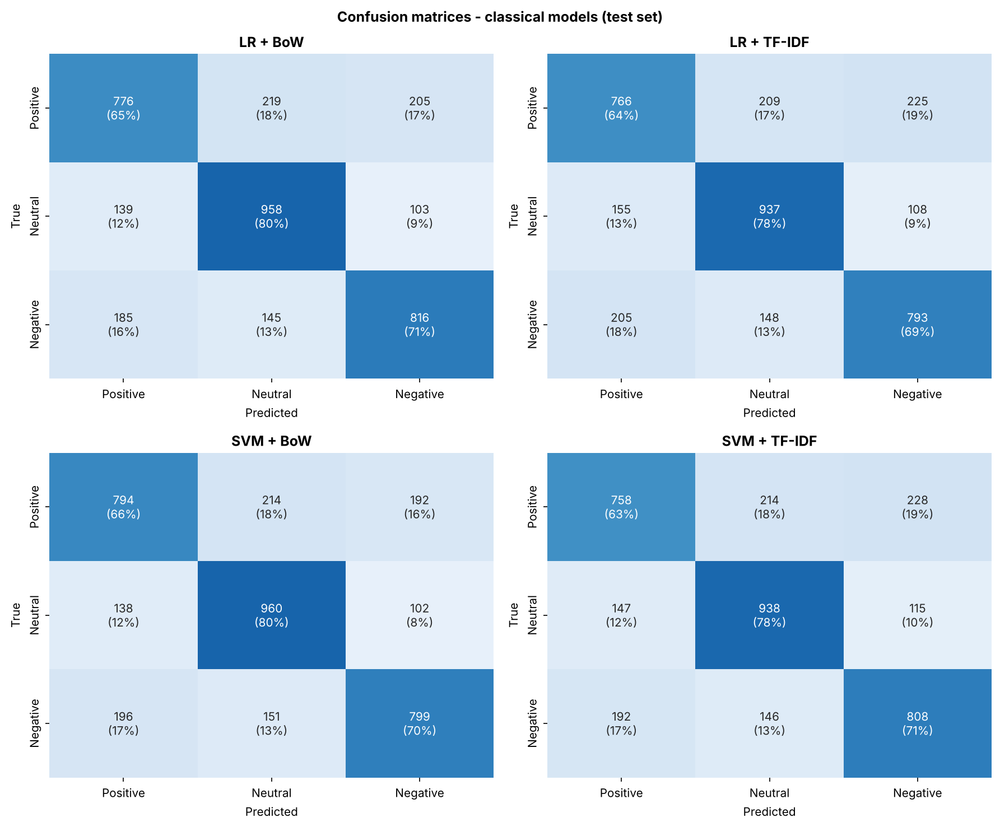
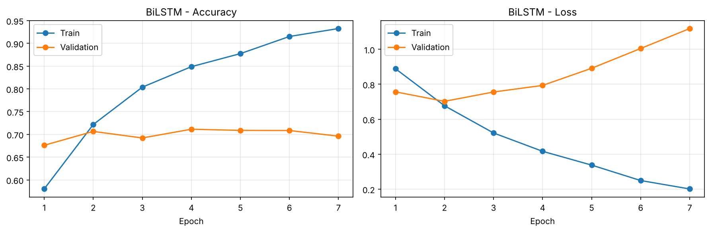

# Financial sentiment analysis: classical ML vs. BiLSTM

Classifying financial news sentences as **positive**, **neutral** or **negative**, comparing bag-of-words models with a **Bidirectional LSTM initialised with Word2Vec embeddings**.

Joint project with Alessia Lecchi and Giacomo Pagani for the course *Artificial Intelligence*, MSc in Analytics and Data Science for Economics and Management, University of Brescia (2026). All authors contributed to every stage.



## Key results

| Model | Accuracy | Weighted F1 |
|---|---|---|
| SVM + Bag-of-Words | 0.720 | 0.719 |
| Logistic Regression + Bag-of-Words | 0.719 | 0.718 |
| BiLSTM + Word2Vec | 0.716 | 0.716 |
| SVM + TF-IDF | 0.706 | 0.705 |
| Logistic Regression + TF-IDF | 0.704 | 0.703 |

*Test set of 3,546 sentences, balanced across the three classes.*

- **The deep model does not beat the linear baselines.** All five models land within 1.6 F1 points, and the BiLSTM scores slightly below a linear SVM on bag-of-words, at a much higher training cost. On short financial headlines, lexical cues carry most of the signal.
- **Bag-of-Words beats TF-IDF for both classifiers** (≈ +1.5 F1 points): down-weighting frequent domain terms removes useful signal rather than noise.
- **Neutral is the easiest class, positive the hardest:** mildly positive financial language often looks neutral. The BiLSTM has the highest recall on positive sentences (0.73 vs. 0.65–0.66 for the bag-of-words models).
- The BiLSTM overfits quickly: validation loss is lowest after 2 epochs, and early stopping restores those weights.

| Confusion matrices (classical models) | BiLSTM training curves |
|---|---|
|  |  |

## Data

[`data/financial_sentiment.csv`](data/financial_sentiment.csv): 35,782 English sentences from financial news, each labelled positive, neutral or negative. It merges two public datasets:

- the [financial sentiment compilation](https://huggingface.co/datasets/RobertoMCA97/financial_sentiment_analysis_train_compilation_v2) on Hugging Face;
- [Sentiment Analysis for Financial News](https://www.kaggle.com/datasets/ankurzing/sentiment-analysis-for-financial-news) on Kaggle, based on the Financial PhraseBank by Malo et al. (2014), *Good Debt or Bad Debt: Detecting Semantic Orientations in Economic Texts*, JASIST 65(4).

After removing duplicates, 33,283 sentences remain (40% positive, 37% neutral, 23% negative). Positive and neutral sentences are undersampled to 8,000 each, giving an almost balanced set of 23,638 sentences, split 70 / 15 / 15 into training, validation and test sets, stratified by class.

## Methods

1. **Cleaning** (shared): encoding fixes, removal of URLs, mentions, tickers, hashtags and emoticons.
2. **Two preprocessing pipelines**, one per model family:
   - classical ML: lowercasing, stopword removal (keeping *no*, *not*, *but*), lemmatisation;
   - deep learning: lowercasing only, preserving word order and function words.
3. **Representations:** Bag-of-Words and TF-IDF (unigrams + bigrams); Word2Vec skip-gram embeddings (200 dimensions) trained on the training set.
4. **Models:** Logistic Regression and linear SVM on each sparse representation; a Bidirectional LSTM (64 units per direction, dropout, early stopping) whose embedding layer is initialised with the Word2Vec vectors and fine-tuned.

The [project report](docs/report.pdf) gives the full methodology, a literature review and an explainability analysis with SHAP.

## How to run

```bash
pip install -r requirements.txt
jupyter notebook financial_sentiment_analysis.ipynb
```

The notebook runs end to end on a CPU in about 10–20 minutes. All random seeds are fixed (`RANDOM_STATE = 42`, deterministic TensorFlow ops, single-threaded Word2Vec), so the results above are reproduced exactly. The trained BiLSTM and its tokenizer are saved to `models/`, which is not tracked by git.

## Repository structure

```
├── financial_sentiment_analysis.ipynb   # full pipeline, with outputs
├── data/financial_sentiment.csv         # labelled sentences
├── figures/                             # model comparison, confusion matrices, training curves
├── docs/report.pdf                      # project report
└── requirements.txt
```
